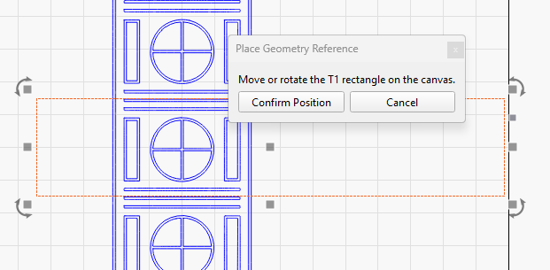
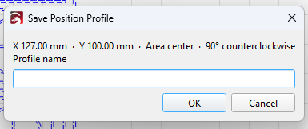

# Taper Warp Tools for LightBurn

An unofficial extension that pre-compensates vector designs for engraving on tapered drinkware. It adds two tools below **Taper Warp** in LightBurn's **Laser Tools** menu.

> This project aims to extend LightBurn's capabilities and make it easier to use, with respect for LightBurn and the work of its developers.

- **Taper Warp v2** uses a virtual reference rectangle so you can position the design within the engraving area.
- **Dual Taper Warp** models straight sections at the top and bottom and an adjustable curved transition between them.

Both tools preserve the design height, save their settings separately, and let you compare the compensated preview with the original. **Apply** creates an undo step in LightBurn. Text is converted to paths, and groups may be converted to individual paths. Select vector artwork to use either tool.

Each tool can save its own geometry profiles. Both tools share engraving-position profiles, which capture the center of the current selection and the chosen placement rotation. Enable **Place at saved position** to rotate the warped result by the chosen angle and center it at that position. One **Undo** reverses the warp, rotation, and placement.

**Place Geometry Reference…** adds a movable T1 rectangle to the canvas for calibrating an engraving position. Profiles saved from the rectangle keep the artwork's **Distance from top** relative to the engraving area.

## Screenshots

**Dual Taper Warp** previews compensation across three vessel zones. The dialog shows the selected geometry and engraving position profiles.


**Place Geometry Reference** lets you move or rotate the T1 rectangle on the LightBurn canvas. Select **Confirm Position** when it is in place.



**Save Position Profile** shows the captured coordinates and rotation so you can check them before naming the profile.



**Taper Warp v2** shows the compensated design inside the virtual reference rectangle. The selected position profile controls where the result goes on the canvas.


Both tools appear under **Taper Warp** in the **Laser Tools** menu.


## Compatibility

The Windows x64 launcher verifies the full executable SHA-256 and checks the mapped image before loading the extension.

| LightBurn | Executable SHA-256 | Verification |
| --- | --- | --- |
| 2.1.04 | `68a80dabab4b05c3773a231d3aaaa0adf64df61b4bee2aeced6fa369b0ef149b` | Existing adapter carried forward |
| 2.2.01 | `1c7c1d2d0843535bcd3188b569ca2b1ace5c1281eb0324de9aa881ebb65b4b3b` | Static checks and standalone tests passed. |

See the [installation guide](INSTALL.md) for the portable ZIP and manual test steps.

## Build and package

Install Visual Studio 2022 or Build Tools with the x64 C++ tools and Windows SDK. Open **x64 Native Tools Command Prompt for VS** in the repository folder.

```bat
build.cmd
```

The script builds the launcher and DLL in `build/` and runs the compensation, preview and build-profile tests without starting LightBurn. Building requires neither the Qt SDK nor any LightBurn files. To create the portable ZIP and its SHA-256 checksum, run this from the same prompt.

```bat
package.cmd
```

The package is written to `dist/`.

See the [REA porting guide](docs/PORTING_WITH_REA.md) for updating the adapter when LightBurn releases a new build.

## Contact

For questions or feedback about this project, email [motar2kfan@gmail.com](mailto:motar2kfan@gmail.com).
